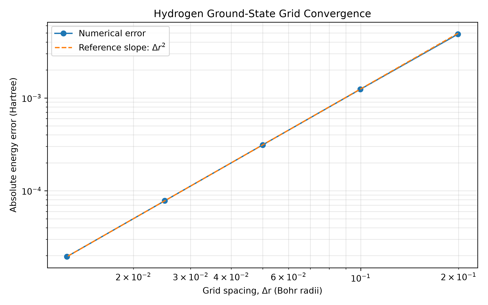
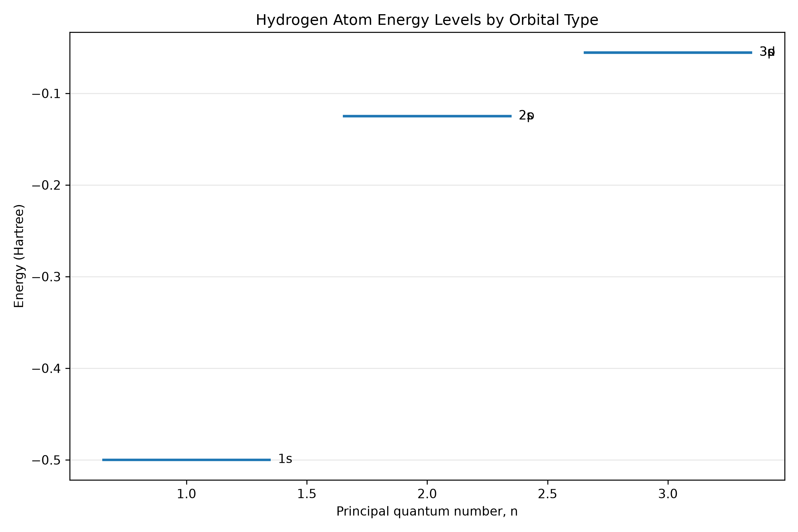
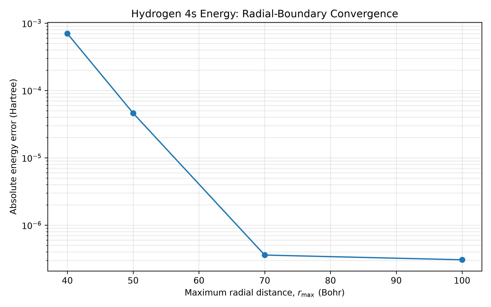

# Hydrogen Atom and Orbitals

A computational quantum chemistry project that solves the hydrogen atom's radial Schrödinger equation using finite differences. Numerical energies and wavefunctions are compared with analytical solutions to assess accuracy and convergence.

## Objectives

- Construct the radial Hamiltonian for the hydrogen atom.
- Calculate energy eigenvalues using a sparse matrix eigensolver.
- Compare numerical energies with analytical hydrogen energy levels.
- Validate radial wavefunctions through normalisation, orthogonality and node counts.
- Investigate grid-spacing and radial-boundary convergence.
- Visualise three-dimensional orbital probability densities.
- Generate reproducible numerical results, CSV files and figures.

## Physical Model

The reduced radial Schrödinger equation in atomic units is

$$
\left[-\frac{1}{2}\frac{d^2}{dr^2}
-\frac{1}{r}
+\frac{l(l+1)}{2r^2}\right]u(r)=Eu(r),
$$

where $u(r)=rR(r)$, $r$ is the radial coordinate and $l$ is the orbital angular momentum quantum number.

The analytical hydrogen energy levels are

$$
E_n=-\frac{1}{2n^2}\ \text{Hartree},
\qquad n>l\geq 0.
$$

## Numerical Method

The radial domain is discretised using a uniform grid. The second derivative is approximated using central finite differences, resulting in a sparse, symmetric, tridiagonal Hamiltonian matrix.

The eigenvalue problem is solved using SciPy. The computed reduced radial wavefunctions are normalised on the discrete grid.

The finite outer boundary and finite grid spacing introduce numerical errors, so the results are compared with analytical solutions and examined under grid refinement.

## Technologies

- Python 3.12
- NumPy
- SciPy
- Matplotlib
- pytest
- scikit-image

## Project Structure

```text
03_Hydrogen_Atom_and_Orbitals/
├── figures/
├── report/
│   └── technical_report.md
├── results/
├── scripts/
├── src/
│   └── hydrogen_atom/
│       ├── __init__.py
│       ├── constants.py
│       ├── radial.py
│       └── solver.py
├── tests/
├── theory/
├── .gitignore
├── requirements.txt
└── README.md
```

## Setup

Create and activate a virtual environment:

```bash
python3 -m venv .venv
source .venv/bin/activate
```

Install the project dependencies:

```bash
python -m pip install --upgrade pip
python -m pip install -r requirements.txt
```

## Running the Calculations

Ground-state energy, wavefunction and probability-density plots:

```bash
python -m scripts.ground_state
```

Lowest four s-state energies:

```bash
python -m scripts.excited_states
```

Selected s-, p- and d-state energy comparisons:

```bash
python -m scripts.orbital_states
```

Ground-state grid convergence:

```bash
python -m scripts.convergence_study
```

Radial-boundary convergence for the 4s state:

```bash
python -m scripts.boundary_convergence
```

Three-dimensional orbital probability-density visualisations:

```bash
python -m scripts.orbital_visualisation
```

## Running the Tests

Run the complete test suite with:

```bash
PYTEST_DISABLE_PLUGIN_AUTOLOAD=1 python -m pytest -v
```

The latest previously reported test run passed **70 tests**, including input-validation checks and analytical radial-wavefunction comparisons for the 1s, 2s and 2p states. This count should be updated if a new test run gives a different result.

## Results and Validation

### Ground-state energy

For a calculation with 2,000 radial grid points and an outer boundary of 50 Bohr radii, the reported numerical ground-state energy was approximately

$$
E_{\mathrm{numerical}}=-0.4999219774\ \text{Hartree}.
$$

The analytical value is $-0.5$ Hartree. The absolute error is approximately $7.80\times10^{-5}$ Hartree, corresponding to a relative error of approximately 0.0156%.

### Grid convergence

A ground-state convergence study used 250, 500, 1,000, 2,000 and 4,000 grid points, with the outer boundary fixed at 50 Bohr radii.

The absolute energy error decreased from approximately $4.86\times10^{-3}$ Hartree at 250 points to $1.95\times10^{-5}$ Hartree at 4,000 points. Halving the grid spacing reduced the error by approximately a factor of four, consistent with second-order finite-difference convergence.



### Orbital energy levels

The calculated 1s, 2s, 2p, 3s, 3p and 3d energies closely matched the analytical hydrogen spectrum. The small differences between states with the same principal quantum number arise from numerical discretisation and the finite computational domain.



### Radial-boundary convergence

A separate diagnostic investigated the 4s state while increasing the outer boundary from 40 to 100 Bohr radii at approximately constant grid spacing.

At $r_{\max}=100\,a_0$, the absolute energy error was approximately $3.05\times10^{-7}$ Hartree. This demonstrates that the outer boundary can materially affect excited-state accuracy.



### Wavefunction validation

The automated tests cover radial-grid construction, effective-potential terms, Hamiltonian properties, energy accuracy, wavefunction normalisation, selected excited-state energies, radial-node counts and orthogonality.

Numerical radial wavefunctions are also compared with analytical solutions for the 1s, 2s and 2p states. Three-dimensional probability-density visualisations are generated for selected hydrogen orbitals.

## Limitations and Future Work

The computational domain is finite, and the grid introduces discretisation error. Although the ground-state grid convergence and 4s boundary diagnostic show encouraging behaviour, further work could investigate convergence across more states and angular momentum sectors.

Further improvements could include wavefunction comparisons for additional states, more extensive orthogonality tests across angular-momentum sectors, and improved orbital rendering.

## Reproducibility

Run the calculation scripts from the project root. Numerical data are saved as CSV files under `results/`, and figures are saved as PNG files under `figures/`. The radial-boundary study writes `results/boundary_convergence.csv` and `figures/boundary_convergence.png`.

The reported numerical values and test count reflect the project's previously reported run; rerun the scripts and test suite to verify them against the current checkout.